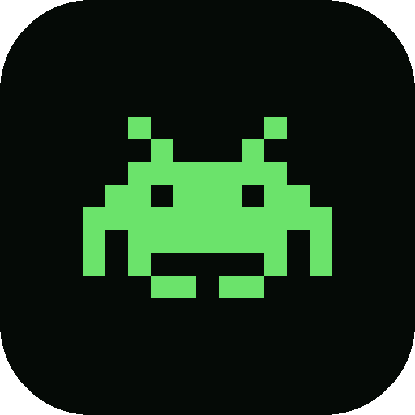
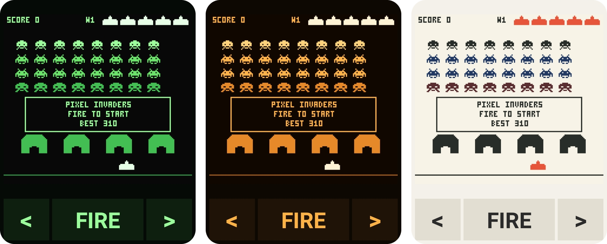

<p align="center">
  
</p>

<h1 align="center">Pixel Invaders</h1>

<p align="center">
  A retro alien shooter that lives on your Android home screen as a resizable widget,<br>
  in three themes: <b>Green phosphor</b>, <b>Amber CRT</b> and <b>Paper</b>.<br>
  Supports Android 10 and above.
</p>

<p align="center">
  
  
  
</p>

<p align="center">
  
</p>

<p align="center"><sub>Green phosphor · Amber CRT · Paper (screenshots from a real phone)</sub></p>

## About this project

Pixel Invaders was created and directed by [IcarusWinged](https://github.com/IcarusWinged). **The code and
pixel art were written by AI** (Claude, by Anthropic) from IcarusWinged's brief, and the app was tested
on a real phone: a Samsung Galaxy A6+ running Android 10. It installs, the widget runs and is playable, and the
best score is saved. It is still a debug build that has only been tried on that one device, so other phones and
Android versions are untested. Bug reports are welcome.

## Download

[**Download the latest APK**](https://github.com/IcarusWinged/pixel-invaders/releases/latest/download/pixel-invaders-debug.apk)
(or see all builds on the [Releases page](https://github.com/IcarusWinged/pixel-invaders/releases)).

1. Open the link on your phone and allow "install unknown apps" for your browser when asked.
2. Open the downloaded APK to install it.
3. Long-press the home screen, open **Widgets**, and add **Pixel Invaders**.

The installed app also has a **Download latest APK** button, so you can fetch updates from inside it.
This is a debug build, so Android may show a warning during install.

## Features

- **Play on the home screen:** `<` and `>` move the ship (it glides smoothly), `FIRE` starts, shoots and retries.
- **Resizable widget:** defaults to 4x4; the pixel art scales by whole numbers so it stays sharp.
- **Waves that ramp up:** aliens march faster as they die and as waves progress, and drop a row at each wall.
- **Custom retro art:** three original alien designs with two animation frames each, a UFO bonus ship,
  player ship, bombs, explosions and a tiny 3x5 pixel font, all in one 160x32 sprite sheet
  (`docs/spritesheet_preview.png`).
- **Destructible bunkers:** four shields that erode pixel by pixel from your shots, enemy bombs, and
  marching aliens.
- **Settings:** Easy / Normal / Hard (lives, alien speed, bomb rate) and three screen themes
  (green phosphor, amber CRT, paper).
- **Best score saved** between sessions.
- **Battery friendly:** the game loop only runs while you are playing and stops itself when idle.

## Collision logic

All game logic is plain Kotlin on a fixed 60 Hz tick, so it behaves the same at any frame rate.

- Every projectile is **swept** along its path each tick, so fast shots cannot tunnel through targets.
- When several targets lie on a shot's path, the **nearest contact wins**.
- Bunkers are **pixel masks**: shots scan the exact pixels they cross and carve a ragged hole.
- Your bullet can cancel an alien bomb. One bullet at a time, at most 3 bombs, brief invulnerability on respawn.

## Project layout

```
app/src/main/java/com/icarus/pixelinvaders/
  game/     GameConfig, Collision, Shield, GameState, GameEngine (pure Kotlin), GameSession
  render/   Sprites (sheet layout), Palette (themes), GameRenderer (Canvas, integer scaling)
  widget/   InvadersWidgetProvider (lifecycle), WidgetUpdater (RemoteViews + button intents)
  service/  GameLoopService (foreground loop, auto-stops when idle)
  data/     SettingsStore (difficulty, theme, best score)
  ui/       ConfigActivity (settings, updates), AppLinks
app/src/main/res/drawable-nodpi/spritesheet.png   generated sprite sheet
app/src/test/                                     JVM unit tests (collision, shields, engine, sheet integrity)
tools/make_assets.py                              regenerates the sprite sheet and launcher icon (needs Pillow)
.github/workflows/build.yml                       tests + debug APK build + latest release
```

## Build

CI runs on every push: unit tests, then `assembleDebug`. Pushes to `main` also publish the APK to the
`latest` release. Locally: `gradle :app:testDebugUnitTest :app:assembleDebug` (JDK 17 + Android SDK).

To change the art, edit the ASCII sprites in `tools/make_assets.py`, run it, and keep
`render/Sprites.kt` in sync (`SpriteSheetTest` fails if they drift).

## Credits

| | Who |
|---|---|
| **Idea and requirements:** a retro space shooter as a resizable, adjustable home-screen widget with a custom sprite sheet and smooth collisions | IcarusWinged |
| **Design decisions:** controls, themes, app and widget name, in-app APK download, MIT license, going public with a clean history | IcarusWinged |
| **Testing on a real device** (Galaxy A6+, Android 10) and the screenshots above | IcarusWinged |
| **Repository owner and publisher** | IcarusWinged |
| Code, pixel art, unit tests and CI, written to that brief | Claude (AI) |

## License

[MIT](LICENSE). Provided as is, with no warranty. This is an AI-written project tested on a single device, so use it at your own risk.
